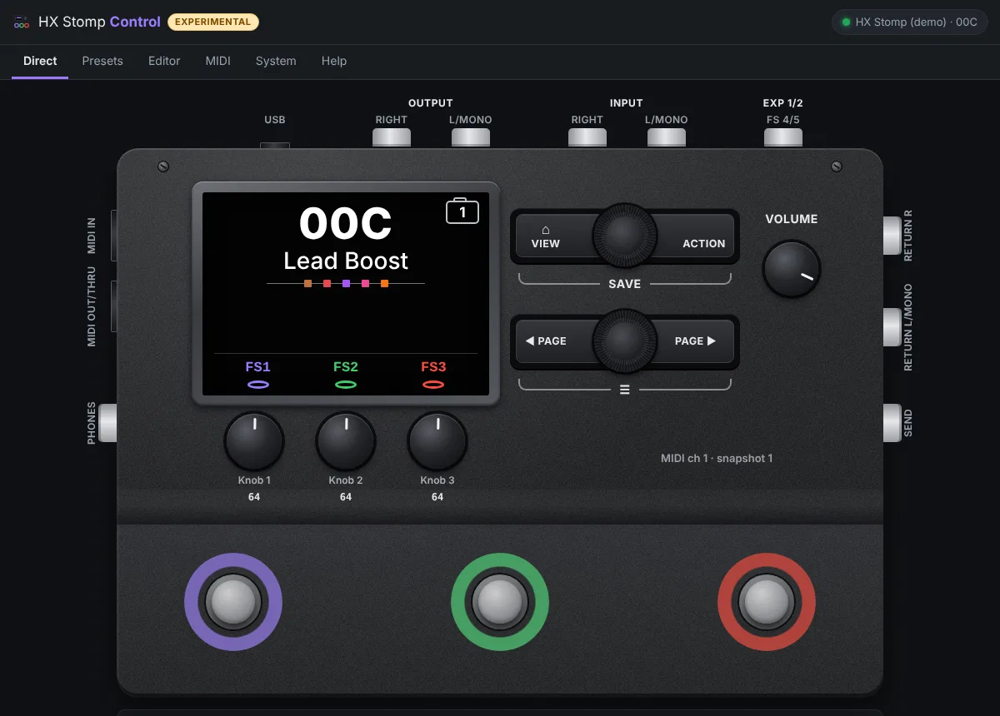
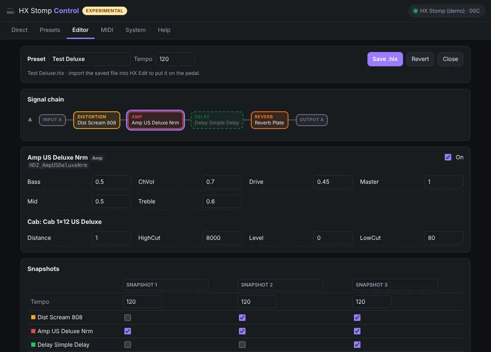
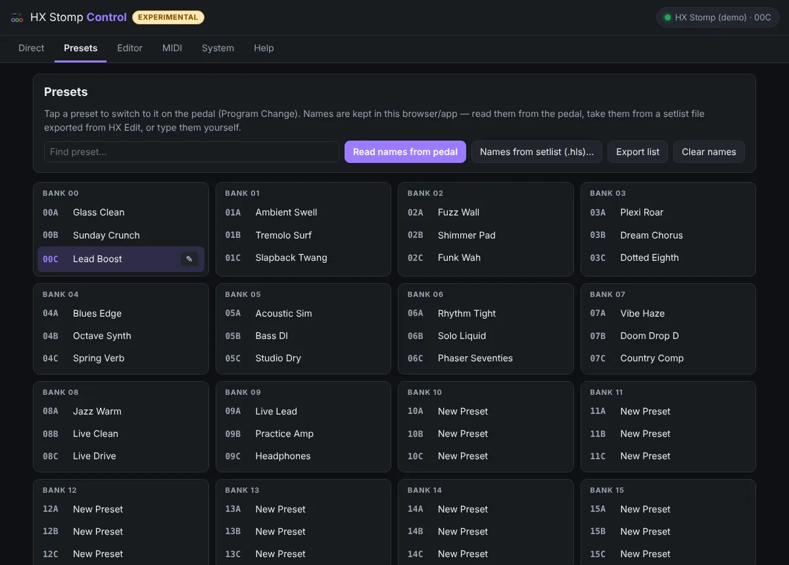
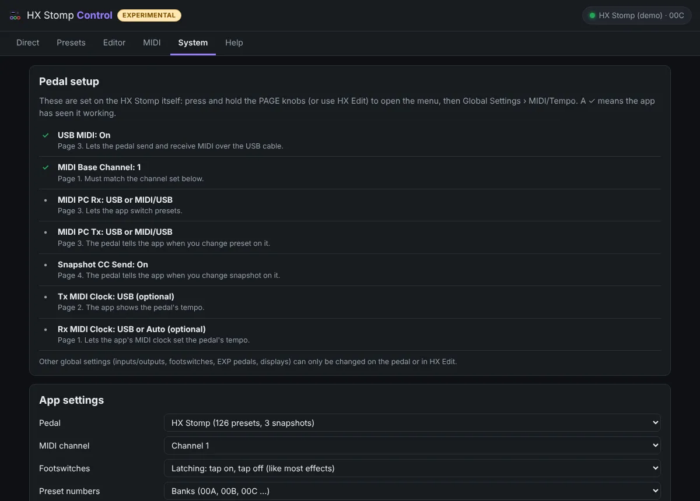
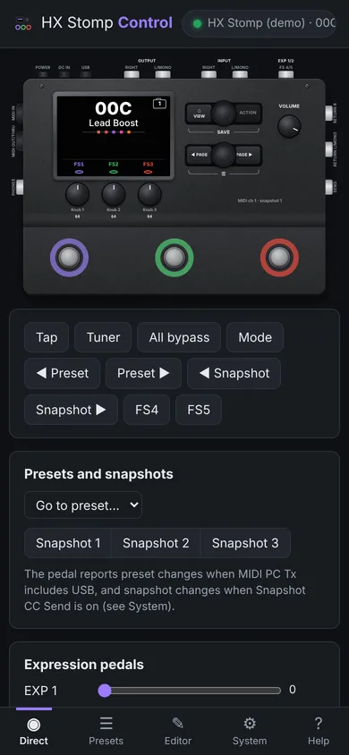

# HX Stomp Control (web + Android)

Play and edit a **Line 6 HX Stomp** from your phone or browser: an on-screen pedal that drives the
real one over USB, a preset list, an editor for preset and setlist files, a MIDI monitor and a setup
guide. Use it in the browser or as a standalone Android app.

> ⚠️ **Experimental and under development.** Independent hobby project, not affiliated with Line 6 or
> Yamaha Guitar Group.

**[Open the web version](https://jonsolberg.github.io/hxstompforandroid/)** ·
**[Try the demo (no pedal needed)](https://jonsolberg.github.io/hxstompforandroid/?demo)** ·
**[Download the Android APK](https://github.com/jonsolberg/hxstompforandroid/releases/latest/download/HXStompControl.apk)** ·
[all releases](https://github.com/jonsolberg/hxstompforandroid/releases)

To install the APK, allow your browser or file manager to *install unknown apps* when Android asks.

  

  
  
  
  

*Screenshots from the demo mode, with made-up preset names.*

## Features

- **Direct** – the pedal on screen: FS1–FS3 (momentary, like the real switches) plus external FS4/FS5, the three
  parameter knobs, View, Mode, Page ◀ ▶, preset and snapshot up/down, Tap, Tuner and All bypass. Below it: jump
  to any preset, pick snapshot 1–3 (1–4 on the XL), EXP 1/2 sliders, the looper (record, overdub, play, stop, play
  once, undo, reverse, half speed) and tempo with tap and MIDI clock. Keyboard shortcuts on a computer. The screen
  follows the pedal when you change presets or snapshots on it.
- **Presets** – all 126 presets by bank (00A–41C, or 000–125), with names. Tap one to switch to it. Names come from
  the pedal (Android app), from a setlist file exported from HX Edit, or you type them.
- **Editor** – open a preset (`.hlx`) or a whole setlist (`.hls`) exported from HX Edit. See the signal chain on
  paths A and B, turn blocks on and off, change every setting of every block (including the amp's cab), rename the
  preset, set the tempo, rename snapshots and set which blocks are on and which values change per snapshot, and
  adjust controller ranges. Save, then import the file with HX Edit. Files are written back in HX Edit's own
  format; unchanged files come out identical.
- **MIDI** – a monitor of everything going to and from the pedal, and a way to send your own program and control
  changes.
- **System** – a checklist of the pedal settings Direct mode needs, ticked off when the app sees them work; the
  MIDI channel, pedal model (HX Stomp or XL), preset numbering, theme and your own footswitch labels and colours.
- **Demo mode** – add `?demo` to the address (or start the app with `--ez demo true`) to try everything without a pedal.

### What's not possible (yet)

Line 6's official MIDI implementation can switch presets and snapshots and press the pedal's controls, but it can't
read or change a preset's blocks or the global settings. **Live editing on the pedal** therefore needs the private
USB protocol HX Edit uses. That's being worked out step by step and will come later; the Android app already uses
it to read the preset names.

## Which browser to use

| | Direct, Presets, MIDI | Editor |
|---|---|---|
| **Firefox, Chrome, Edge or Opera** on a computer | ✅ (asks for MIDI permission the first time) | ✅ |
| **Android app** | ✅ plus reading preset names from the pedal | ✅ |
| Safari, iPhone/iPad | ❌ no Web MIDI | ✅ |

Web MIDI only works on secure (https) pages, so use the link at the top rather than a copy opened from your disk.

## Setting up the pedal

On the HX Stomp, open Global Settings › MIDI/Tempo and set:

| Setting | Value | Why |
|---|---|---|
| USB MIDI | On | MIDI over the USB cable |
| MIDI Base Channel | the same as in the app (default 1) | |
| MIDI PC Rx | USB or MIDI/USB | the app can switch presets |
| MIDI PC Tx | USB or MIDI/USB | the app follows preset changes made on the pedal |
| Snapshot CC Send | On | the app follows snapshot changes made on the pedal |
| Rx MIDI Clock | USB or Auto (optional) | the app's MIDI clock sets the tempo |
| Tx MIDI Clock | USB (optional) | the app shows the pedal's tempo |

## How Direct mode talks to the pedal

Only with the MIDI messages documented in the HX Stomp Owner's Manual (firmware 3.80): Program Change 0–125
selects a preset, and these control changes do the rest. Footswitches are sent as 127 on press and 0 on release.

| CC | Values | What it does |
|---|---|---|
| 1, 2 | 0–127 | EXP 1, EXP 2 |
| 49–53 | press 64–127, release 0–63 | FS1–FS5 |
| 60 | 0–63 overdub, 64–127 record | Looper record/overdub |
| 61 | 0–63 stop, 64–127 play | Looper play/stop |
| 62 / 63 | 64–127 | Looper play once / undo |
| 64 | 64–127 | Tap tempo |
| 65 / 66 | 0–63 / 64–127 | Looper forward/reverse, full/half speed |
| 68 | 0–127 | Tuner on/off |
| 69 | 0–3, 8 next, 9 previous | Snapshot |
| 70 | 0–63 bypass, 64–127 on | All bypass |
| 71 | 0–5 | Footswitch mode (the app sends 4 = next) |
| 72 | 0–63 previous, 64–127 next | Preset down/up |
| 73 | 0–127 | Play/Edit view |
| 75–77 | 0–127 | Parameter knobs 1–3 |
| 81 | 0–63 left, 64–127 right | Page |

## Building

- **Web**: plain HTML/CSS/JS in [`web/`](web), no build step. The `pages` workflow publishes it to GitHub Pages.
- **Android**: the app bundles `web/` as its assets and adds a native bridge ([`MainActivity.kt`](app/src/main/java/se/jonsolberg/hxstomp/MainActivity.kt))
  for USB MIDI (`android.media.midi`), saving files and reading preset names through the pedal's editor interface
  ([`usb/`](app/src/main/java/se/jonsolberg/hxstomp/usb)). Push to GitHub – the `build` workflow runs the tests, builds
  the APK and publishes it as a release. The `Screenshots` workflow runs the app on an emulator in demo mode.

## Credits

Reading preset names uses the USB protocol as documented by [OpenHX](https://github.com/allansomensi/openhx)
(MIT licence, © 2026 Allan Somensi) – see [THIRD_PARTY_NOTICES.md](THIRD_PARTY_NOTICES.md). The MIDI implementation
follows the HX Stomp Owner's Manual. Line 6, HX Stomp, HX Edit and Helix are trademarks of Yamaha Guitar Group, Inc.

## Support

HX Stomp Control is free, open source and has no ads. If you find it useful, you can
[support me on Ko-fi](https://ko-fi.com/jonsolberg) ❤️

## License

Copyright © 2026 Jon Solberg

This program is free software: you can redistribute it and/or modify it under the terms of the
GNU General Public License as published by the Free Software Foundation, either version 3 of the
License, or (at your option) any later version.

This program is distributed in the hope that it will be useful, but WITHOUT ANY WARRANTY; without
even the implied warranty of MERCHANTABILITY or FITNESS FOR A PARTICULAR PURPOSE. See the
[GNU General Public License](LICENSE) for more details.
